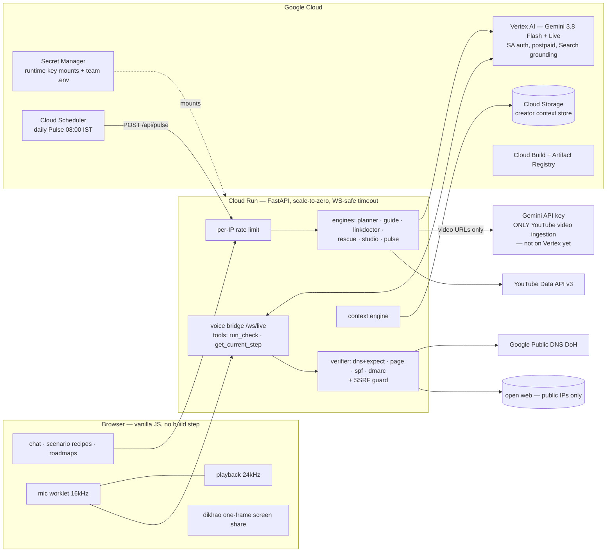

# Raahi — system architecture (v0.1)

*Design goal: a creator's fiduciary engineer — decide on the creator's side,
guide in their language, **prove** outcomes independently. Everything below
serves those three verbs; anything that doesn't is listed under
"deliberately not built."*

## 1 · Principles (each one is enforced in code, not aspiration)

| Principle | Where it lives |
|---|---|
| **Verification-first** — "done" is a checked fact. Unknown check types are refused; DNS checks can require an expected destination; manual confirmation renders as *done (your word)*, never verified | `verifier.py` |
| **Honest degradation** — a dependency dying produces a labeled partial result, never a fake success or a bare 500 | Rescue returns steps marked "freshness unverified" on grounding outage; Studio falls back from transcript→video ingestion; 429s backoff-retry |
| **Swappable seams** — the parts that will change are isolated | models in `config.py` only; storage behind `store.py` (GCS ↔ local); AI backend behind a `client()` seam (Vertex ↔ API key) |
| **Least privilege & no secrets in code** — keys are Secret Manager mounts; the runtime SA holds only `aiplatform.user` + secret accessor; collaborators get viewer | IAM, deploy config |
| **Disclosed AI** — predefined recipes are badged *recipe*; model output is badged *ai-planned*; the model may only narrate measured diffs in Pulse | UI badges, `pulse.py` |

## 2 · System diagram

## 3 · The hybrid AI decision (and why it's not a hack)

All reasoning runs on **Vertex AI** with service-account auth: no key in the
request path, postpaid project billing (kills free-tier quota fragility),
org-grade controls. One capability — ingesting a YouTube URL as video — is a
**Gemini-API-only feature today**; those two call sites (`studio`, `rescue`
extraction) explicitly use the mounted key via `gemini.key_client()`. When
Vertex gains YouTube ingestion, the hybrid collapses to one line deleted.
Rollback of the whole Vertex move is one env var (`USE_VERTEX=0`).

## 4 · Failure modes → designed behavior

| Failure | What the user sees |
|---|---|
| Gemini 429 / per-minute quota | automatic backoff-retry (20s, 40s); then a readable error — never a blank spinner |
| Search grounding outage | Rescue still returns extracted steps, each labeled "NOT verified against current docs" |
| YouTube blocks transcript (cloud IPs) | Studio switches to video ingestion; UI notes "cloud mode — captions need a local run" |
| Live session GoAway (~10 min) | client reconnects (capped ×3, backoff) carrying roadmap state |
| One malformed link in 105 | that link reports `unreachable`; the scan completes |
| Check target on a private/metadata IP | refused by the SSRF guard, stated plainly |
| API flood | 40 req/min per IP → 429 with retry advice |
| Page refresh mid-roadmap | state restores from localStorage ("Resumed your plan") |
| Secret rotation | new Secret Manager version; next revision picks it up — no code change |

## 5 · Data & privacy

Context store holds **public channel data + task state only** (snapshots,
decisions, learned concepts) — no passwords, no OAuth tokens, no audio
retention. The guide's system prompt hard-forbids asking for passwords/OTPs.
Screenshots are single frames sent at the user's explicit request.

## 6 · Deliberately NOT built (the anti-over-engineering list)

| Rejected | Why — and the trigger that would change the answer |
|---|---|
| Firestore/SQL | GCS JSON docs serve single-digit RPS fine; migrate when profiles need queries/transactions (team features) |
| Message queue + workers | longest job ≈ 90 s, inside Cloud Run's request model; Cloud Tasks arrives **with** v2 rendering, not before |
| Kubernetes / Terraform / microservices | one container, one `deploy.sh`; split when teams split |
| Redis cache | disk cache + 24 h TTL is enough at this scale |
| Auth/accounts | demo-stage; ships with the first private data (OAuth analytics) — currently nothing stored is private |
| LangChain/agent frameworks | two SDK calls and explicit prompts are more auditable than a framework |
| Load balancer / CDN / multi-region | Cloud Run's managed URL until there's traffic evidence |

## 7 · Evolution (each step has a trigger, not a date)

v0.1 (now) → **v1** Context/Pulse deepen: OAuth analytics read, Firestore if
query needs appear, Cloud Tasks for scheduled fleets → **v2** Studio
rendering: FFmpeg on Cloud Run Jobs + GCS artifacts (this is when queues and
durable job state earn their place) → **north star**: the verification layer
exposed as its own API — audit-as-a-service for the agent economy.
