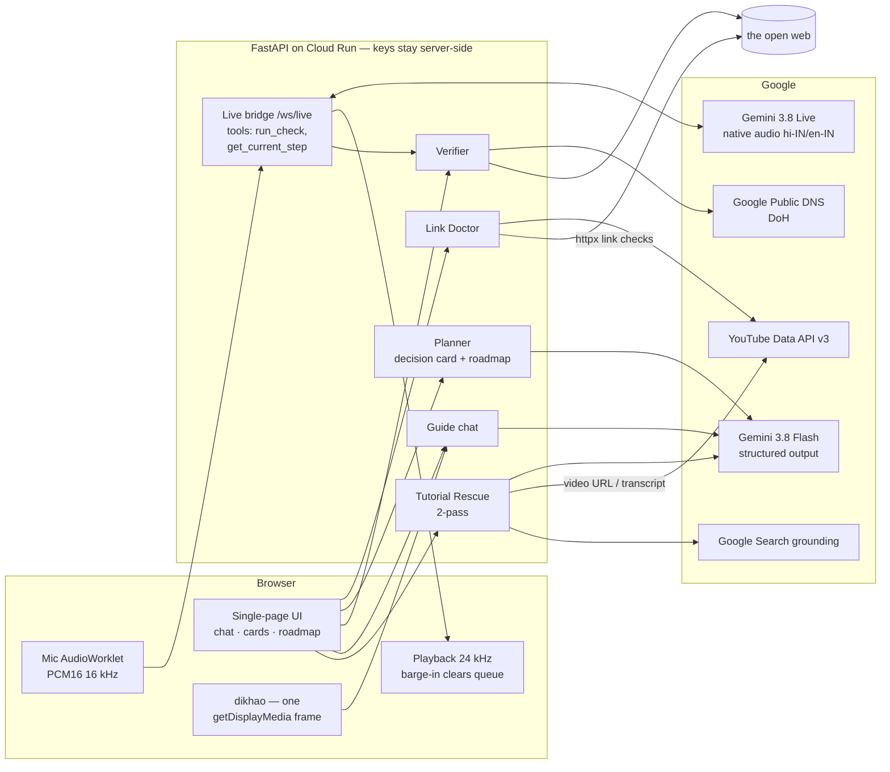

# Raahi — architecture

Design rules baked in:
- **Voice is a layer, not a dependency** — every feature works over text, so a
  Live failure never kills the demo.
- **Hints before answers** (PNAS 2025: answer-giving tutors harm learning).
- **Trust the check, not the screen** — DNS/page verification decides "done".
- **One screenshot on request, never a stream** — fits Live's ~2-min
  audio+video cap and the user's privacy.
- **Curated tool catalogue** — prices and difficulty are vouched for, not
  hallucinated.
